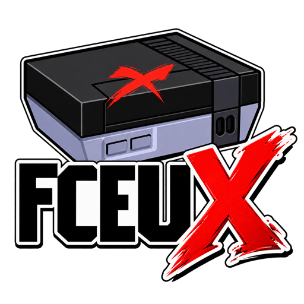

  

# fceuX

fceuX is a Windows fork of [FCEUX](https://github.com/TASEmulators/fceux) with Miracle Piano support and quality-of-life changes.

**Download:** the latest zip from [Releases](../../releases). Unzip anywhere and run `fceuX.exe`. No games or system files are included.

## Features

* Interactive R.O.B. peripheral viewer for Gyromite and Stack-Up.
* Two color-coded gyros with 60-second spin timers, wobble indicators, and automatic holder resets.
* B hotkey to toggle the R.O.B. viewer.
* Miracle Piano support with a separate mouse- and touch-enabled keyboard.
* Game-driven piano audio for title music, demonstrations, lessons, and live keyboard input.
* Keyboard volume control up to 400% and toggleable sustain pedal.
* Resizable, maximizable peripheral windows with saved positioning and disconnected-monitor fallback.
* Delayed piano focus return to the main game window.
* Persistent input-device selections and live controller/peripheral switching.
* Borderless fullscreen with automatically hidden menus revealed at the top mouse edge.
* Update check: a startup pop-up only when a newer release exists (never during a game), Help > Check for Updates, and a Help setting to turn the startup check off.
* fceuX -v / --version prints the version for front ends such as LaunchBox.

The update check makes one HTTPS request to GitHub's releases API when fceuX starts (or when you choose Check for Updates) and sends nothing but the request itself. Turn it off under Help.

## Building

Windows, MSVC + Qt 6 + SDL2: configure the repository root with CMake (`-DCMAKE_PREFIX_PATH=<Qt msvc dir> -DSDL_INSTALL_PREFIX=<SDL2 dir with include/ and lib/x64/>`), then build Release. The executable is named `fceuX.exe`.

## License and credits

Licensed under GPL-2.0-or-later, as FCEUX. Thanks to the FCEUX developers for the emulator this is built on.
